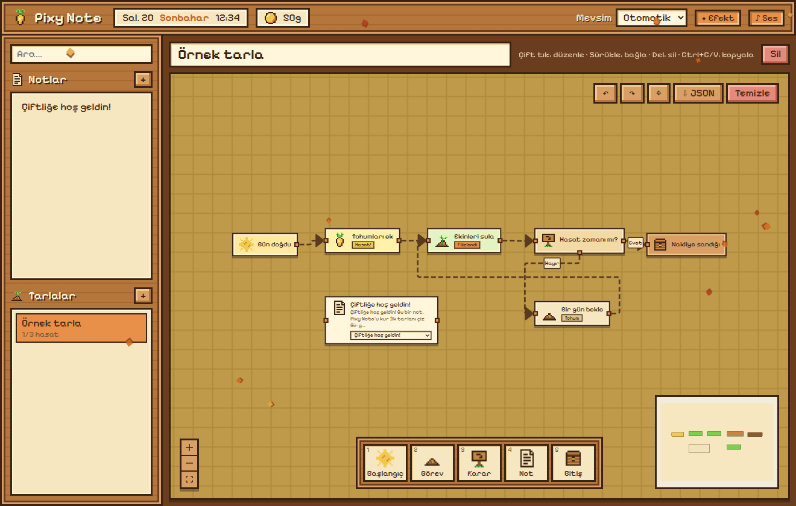

# Pixy Note 🌱




Stardew Valley estetiğinde kişisel not uygulaması.

## Çalıştırma

```bash
npm install
npm run dev        # geliştirme: Vite + Electron, kaydedince anında yenilenir
npm start          # derleyip Electron ile aç
npm run dist       # Linux için AppImage üretir (release/ klasörüne)
npm run dev:web    # sadece tarayıcıda (veriler localStorage'a yazılır)
```

## Masaüstü simgesi (dock)

```bash
npm run desktop -- --pin     # derler, uygulama menüsüne ekler ve dock'a sabitler
npm run desktop              # sadece menüye ekle (sabitlemeden)
node scripts/install-desktop.cjs --remove   # menüden ve dock'tan kaldır
npm run icon                 # electron/icon.png simgesini yeniden üret
```

Simge, derlenmiş sürümü (`dist/`) açar. Kodu değiştirdikten sonra `npm run build` çalıştırman yeterli.
Uygulama tek kopya çalışır: zaten açıkken simgeye tıklarsan mevcut pencere öne gelir.

## Özellikler

- **Notlar**: zengin metin editörü (başlık, liste, görev listesi, kod, alıntı). Otomatik kaydedilir.
  - **Vurgu** (`A ▾`): seçili metni 6 renkten biriyle fosforlu kalemle boya (`Ctrl+Shift+H` hızlıca sarı vurgu ekler/kaldırır)
  - **Renkli blok** (`▣ Blok ▾`): imlecin olduğu paragrafı, listeyi ya da seçili birkaç paragrafı renkli bir kutuya al.
    Blok içindeyken başka renk seçmek rengini değiştirir, "Bloğu kaldır" içeriği dışarı çıkarır.
- **Tarlalar** (workflow tuvali):
  - Alttaki envanter çubuğundan düğümleri tarlaya sürükle: Başlangıç, Görev, Karar, Not, Bitiş
  - Düğümlerin kenarındaki karelerden tutup başka düğüme sürükleyerek bağla
  - Görevin simgesine tıkla: tohum → filiz → hasat (her hasat 50g kazandırır 🪙)
  - Soldaki bir notu tarlaya sürükle: o nota bağlı bir düğüm oluşur; çift tıklayınca not açılır
  - Çift tık: düğüm adını / patika etiketini düzenle
  - `Del` sil · `Ctrl+Z` geri al · `Ctrl+Shift+Z` yinele · `Ctrl+C / Ctrl+V` kopyala-yapıştır
- **Mevsimler**: tarih bazlı otomatik ya da elle seçilen mevsim; tarla rengi ve düşen yaprak/kar efekti değişir.
- **Ses**: 8-bit efektler WebAudio ile üretilir (dosya yok), üst bardan kapatılabilir.

## Veriler nerede?

`~/.config/pixy-note/pixy-data.json` (+ her açılışta `pixy-data.backup.json` yedeği).

## Yapı

```
electron/         Ana süreç (pencere, dosyaya kaydetme) ve preload köprüsü
scripts/          VS Code terminalinde de çalışan Electron başlatıcısı
src/store.ts      Uygulama durumu (zustand)
src/persist.ts    Otomatik kaydetme
src/sprites.tsx   Tüm pikselart (karakter haritası olarak çizildi)
src/components/   Arayüz; board/ altında workflow tuvali ve düğüm tipleri
src/styles/       Tema (ahşap/parşömen paleti, mevsim renkleri)
```

> Görseller tamamen bu projeye özgü pikselart'tır; oyunun kendi dosyaları kullanılmamıştır.
